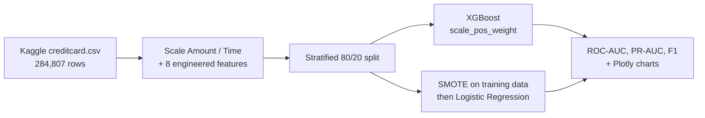

# Credit Card Fraud Detection
**XGBoost vs. Logistic Regression on a highly imbalanced public dataset (0.17% fraud)**


**Live demo:** none. This is a notebook project.  
**Notebook:** [Open in Colab](https://colab.research.google.com/drive/13zeGVos5HIIZyV8jv1klzLXdbXSByfAL)  
**Repo:** [github.com/Machine-Learning-Engineer-1776/Fraud-Detection-in-Credit-Card-Transactions](https://github.com/Machine-Learning-Engineer-1776/Fraud-Detection-in-Credit-Card-Transactions)

---

## What it does

An end-to-end notebook pipeline that:
- Downloads the [Kaggle Credit Card Fraud dataset](https://www.kaggle.com/datasets/mlg-ulb/creditcardfraud) (`mlg-ulb/creditcardfraud`) via `kagglehub`: 284,807 transactions, 492 fraud (0.17%), PCA-anonymized features `V1`–`V28` plus `Time` and `Amount`
- Scales `Amount`/`Time` and engineers 8 features (`hour_of_day`, `time_since_last_txn`, `txn_count_rolling`, `amount_to_median_ratio`, `is_top_5pct_amount`, `avg_amount_per_hour`, `amount_std_rolling`, `amount_deviation`)
- Trains **XGBoost** (with `scale_pos_weight`) and **Logistic Regression** (with **SMOTE** oversampling) on a stratified 80/20 split
- Evaluates with ROC-AUC, PR-AUC, F1 and classification reports
- Produces 5 interactive Plotly charts (probability histogram, class distribution, ROC, PR curve, feature importance)

No deployment; this is a notebook project.

---

## Architecture



Everything runs in one notebook on Colab. There is no server.

---

## Results (test set: 56,962 transactions, 98 fraud)

All numbers are printed in `Model/Fraud_Detection_in_Transactions.ipynb` (evaluation cell).

| Metric | XGBoost | Logistic Regression + SMOTE |
|--------|---------|-----------------------------|
| **ROC-AUC** | 0.977 | 0.975 |
| **PR-AUC** | 0.884 | 0.810 |
| **F1 (fraud class)** | 0.857 | 0.168 |
| **Precision / Recall (fraud)** | 0.89 / 0.83 | 0.09 / 0.92 |

Takeaways:
- ROC-AUC looks similar for both models, but on data this imbalanced **PR-AUC and F1 tell the real story**: XGBoost is far more precise.
- Logistic Regression with SMOTE catches more fraud (92% recall) but flags ~10 legitimate transactions for every real one at the default 0.5 threshold.
- This is a clean, well-studied benchmark dataset; real-world fraud data is messier.


### Next steps
- Tune the decision threshold for Logistic Regression instead of using 0.5
- Compute rolling/time features inside the training split only, to rule out leakage
- Add cross-validation and report variance across folds

---

## How to run

1. Open the [Colab notebook](https://colab.research.google.com/drive/13zeGVos5HIIZyV8jv1klzLXdbXSByfAL) (or `Model/Fraud_Detection_in_Transactions.ipynb`)
2. Run all cells. The dataset is downloaded automatically with `kagglehub` (Kaggle access may be required)
3. Outputs: `preprocessed_creditcard.csv`, `engineered_creditcard.csv`, `features_creditcard.csv`, `target_creditcard.csv`, `predictions.csv`, `model_metrics.csv`, `xgb_model.pkl`, `lr_model.pkl`, and 5 `.html` charts

Main packages: `pandas numpy scikit-learn xgboost imbalanced-learn plotly joblib kagglehub`

To run outside Colab:

```bash
pip install pandas numpy scikit-learn xgboost imbalanced-learn plotly joblib kagglehub jupyter
jupyter notebook Model/Fraud_Detection_in_Transactions.ipynb
```

There is no `requirements.txt` yet, and package versions are not pinned.

---

## Tech stack
pandas, NumPy, scikit-learn, imbalanced-learn (SMOTE), XGBoost, Plotly, joblib, Google Colab

---

## Project structure
```
Model/
  Fraud_Detection_in_Transactions.ipynb   # main notebook (with outputs)
  fraud_detection_in_transactions.py      # script export of the notebook
```

---

Built by Ron Lance, [Alpha Peak Technologies](https://alphapeaktech.com) · [LinkedIn](https://www.linkedin.com/in/ron-lance-49aa2a8/)
